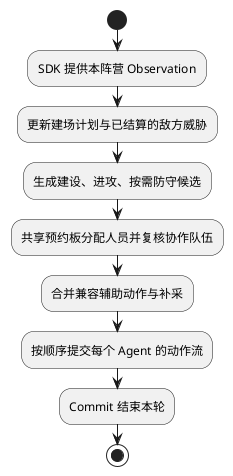

# Adaptive Alpha 参考选手

这是独立的参赛程序仓库，也是 Alpha 测试的蓝军基线。仅保留 Adaptive r2.6：从开局起同时考虑建设、反攻与按需防守，包含组合动作和低库存补采。它来自现有评估中战绩最好的混合策略，但仍是启发式参考实现，不代表最优策略。

## 构建与运行

需要 Linux 和 Rust 1.98.0。将官方 `server` 仓与本仓放在同一 `ingress` 目录下，目录名分别为 `server`、`bot`。两者有独立的 Git 仓、Cargo.toml 和 Cargo.lock；本仓通过相对路径依赖官方 SDK 与游戏类型，不属于 server 的 Cargo workspace。

从本仓执行：

```sh
cargo build --release --locked
cargo test --release --locked
cargo build --release --locked --manifest-path ../server/Cargo.toml
../server/scripts/run-external-match.sh --client "$PWD/target/release/adaptive-bot" --match-id adaptive-demo --export dev
```

脚本同时启动服务器与两个本 Bot 进程，运行默认 500 轮，产物写入 `../server/runs/external/adaptive-demo/`。每次使用新的 match id。回放也可直接交给 [Tactical Replay](../server/viewer/app/README.md) 打开。

默认规则为 **20 HP／1 Supply 充电、1500 m 最大链距**。策略始终读取服务器提供的 `GameConfig`，不在客户端硬编码这两项规则。开发时可用 `--rounds 50` 缩短比赛；`--config fast` 将决策窗口压到 40 ms，仅适合协议冒烟，不能用于评价本策略的能力。

客户端启动接口是两个位置参数：

```sh
target/release/adaptive-bot <server-socket> <十进制无符号种子>
```

阵营由服务器分配。两方必须在握手窗口内连接，日常使用比赛脚本或调度器统一启动。程序正常结束时输出双方得分；启动／SDK 错误退出码为 2，比赛中止为 3。

## 与另一个选手对战

在 server 目录执行，两个 `--client` 分别指向独立构建的二进制；同一路径也可以登记两次做自对战：

```sh
target/release/arena-runner tournament --out runs/alpha-duel \
  --client ../bot/target/release/adaptive-bot --client /absolute/path/to/your-bot \
  --matches 2 --maps 1 --rounds 500 --seed 12648430 \
  --sandbox target/release/sandbox-runner
```

调度器按赛程分配阵营并记录二进制哈希、地图、种子、比赛记录和排名。它要求新的输出目录。开发时可以省略 `--sandbox`；并发数通过 `--workers` 设置，过多并发会争用每轮决策时间。

审核本仓：

```sh
../server/target/release/audit --root ../server --participant .
```

审核涵盖本仓源码、依赖声明和本仓 Cargo.lock。选手不得通过复制系统接口绕过 SDK；完整准入要求见 [官方规则](../server/docs/spec/rules/README.md)。

## 从哪里开始读

| 文件 | 职责 |
|---|---|
| [src/main.rs](src/main.rs) | 读取启动参数，连接服务器，输出结果 |
| [src/client.rs](src/client.rs) | 实现 SDK 的 `ClientBot`：选择出生、读取观察、提交动作与结束本轮 |
| [src/adaptive.rs](src/adaptive.rs) | 策略入口：汇总建设、攻击、防守候选并统一分配 |
| [src/build.rs](src/build.rs) | 建场计划、替代任务、分配复核和动作生成；`CoreParams` 集中放置启发式参数 |
| [src/tasks.rs](src/tasks.rs) | 任务优先级、人员容量与共享预约 |
| [src/attack.rs](src/attack.rs)、[src/defense.rs](src/defense.rs) | 生成攻击／防守候选，共用建设分配器 |
| [src/value.rs](src/value.rs) | 按到达时间、场收入、威胁和资源估计任务价值 |
| [src/compound.rs](src/compound.rs) | 在合法顺序和预算内组合 Recharge／Attack 与 Move／Link／Hack，安排低库存补采 |
| [src/sample.rs](src/sample.rs)、[src/common.rs](src/common.rs) | 有界几何搜索、冷却记忆、合法动作辅助 |
| [src/opponent.rs](src/opponent.rs)、[src/rng.rs](src/rng.rs) | 公开事件推断与可复现随机流 |



编写自己的策略时，可保留 `main.rs` 的连接方式及 `client.rs` 的 SDK 调用，只替换策略决策部分。最小的策略接口只有初始化、选择出生点、根据 `Observation` 返回有序动作流；其余模块是 Adaptive 的具体实现，不是 SDK 的接入要求。

每场必须创建新的策略实例，让同一个实例从出生选择持续运行到终局。只读取己方合法观察；不要用完整回放或敌方私有状态参与决策。一个 Agent 的主动作每轮只有一个，辅助动作仍受移动、命令条数、冷却、资源和结算顺序限制。SDK 提交按实际到达时间分桶，离线测试中设置的虚拟 bucket 不会随客户端提交发送。

## 能力边界与来源

- 保留按需最多两人防守、从开局竞争的反攻、组合建设动作、低库存顺路／当轮可达补采。
- 尚未实现多轮后勤接力、全局最优任务分配或 Transfer 规划。Transfer 价值继续留待更成熟策略评估。
- 没有其它策略、策略注册表、消融开关入口或历史批量实验驱动。历史数据留在 server 的 [balance 文档](../server/docs/balance/README.md) 中。
- 原实现位于 server 提交 `65a5855a27b5da037bf1705ee43f0810113926c9` 的 `crates/arena-bots/src/r2/`；迁移保留 r2.6 默认决策，移除无关策略和研究记录接口。规则调整与仓库职责见 [Alpha 迁移记录](../server/docs/design/alpha-reference.md)。
